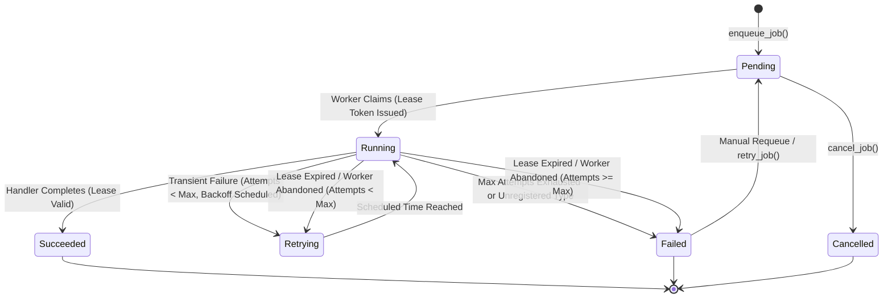
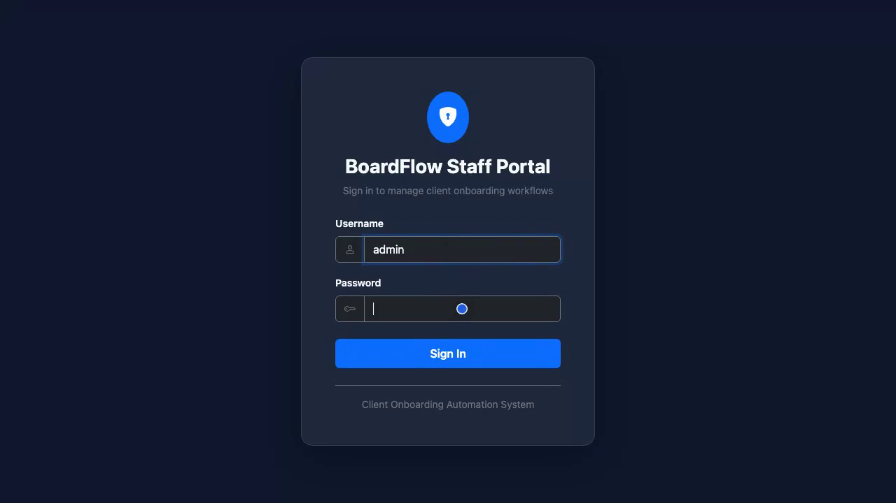
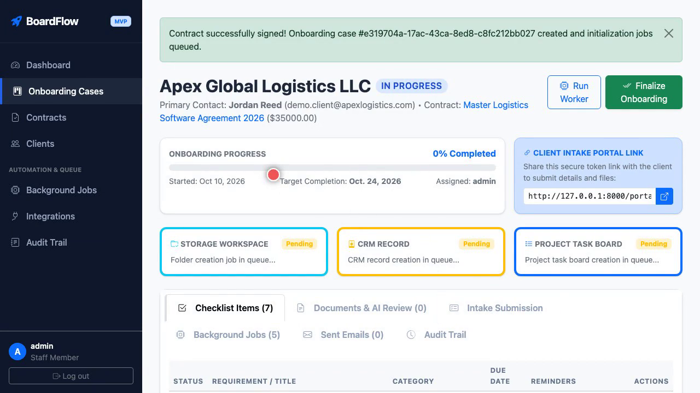
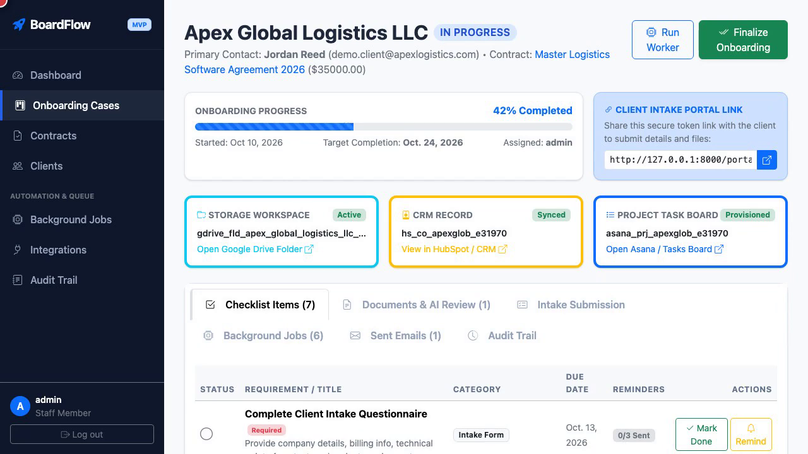
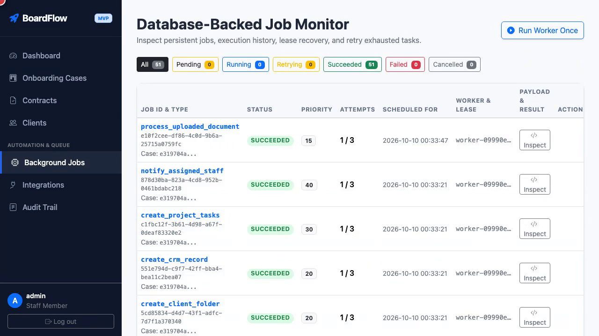

# BoardFlow — Database-Backed Client Onboarding Automation System

A production-minded, database-backed client onboarding automation platform for professional services firms built with **Python, Django, SQLite (with PostgreSQL migration path), and a custom database-backed asynchronous worker**.

---

## 1. Executive Summary & Architecture

BoardFlow automates the client onboarding lifecycle following contract execution—orchestrating client intake, document verification, cloud folder workspace provisioning, CRM deal syncing, task board creation, reminder scheduling, and staff approval—**without requiring external message brokers such as Celery, Redis, RabbitMQ, n8n, or Make.com**.

### System Architecture & Application Modules

```
 ┌────────────────────────────────────────────────────────────────────────┐
 │                              DJANGO CORE                               │
 │                                                                        │
 │  ┌─────────────┐   ┌─────────────┐   ┌─────────────┐  ┌─────────────┐  │
 │  │   clients   │   │  contracts  │   │ onboarding  │  │  documents  │  │
 │  │  (Profiles) │   │ (Signatures)│   │ (Pipelines) │  │  (AI OCR)   │  │
 │  └──────┬──────┘   └──────┬──────┘   └──────┬──────┘  └──────┬──────┘  │
 ├─────────┼─────────────────┼─────────────────┼────────────────┼─────────┤
 │         ▼                 ▼                 ▼                ▼         │
 │  ┌──────────────────────────────────────────────────────────────────┐  │
 │  │              DATABASE-BACKED JOB QUEUE (workflow_engine)         │  │
 │  │   • Persistent Job Model   • Leases & Expiring Tokens            │  │
 │  │   • Atomic Conditional Claiming • Exponential Backoff            │  │
 │  │   • Abandoned Worker Recovery  • Explicit Handler Registry       │  │
 │  └──────────────────────────────────┬───────────────────────────────┘  │
 ├─────────────────────────────────────┼──────────────────────────────────┤
 │                                     ▼                                  │
 │  ┌──────────────────────────────────────────────────────────────────┐  │
 │  │                REPLACEABLE INTEGRATION ADAPTERS                  │  │
 │  │   • Storage / Google Drive      • CRM (HubSpot / Salesforce)     │  │
 │  │   • Task Boards (Asana / Jira)  • Email Delivery & Reminders     │  │
 │  │   • Anthropic Claude API / Deterministic Mock Document Extractor │  │
 │  └──────────────────────────────────────────────────────────────────┘  │
 └────────────────────────────────────────────────────────────────────────┘
```

The platform is cleanly modularized into 8 dedicated Django apps:
* **`workflow_engine`**: Persistent job model, atomic claiming, lease token recovery, exponential backoff, dead-letter retry controls, and the `run_worker` management command.
* **`clients`**: Client profiles, primary contacts, corporate details, and metadata.
* **`contracts`**: Master service agreements, contract values, staff signing actions, and authenticated webhook endpoints.
* **`onboarding`**: Onboarding cases, category-based checklist items, state machines, and token-authenticated client portal.
* **`documents`**: Private, non-public file storage, text extraction, validation flag inspection, confidence scoring, and human verification controls.
* **`integrations`**: Abstract interfaces and mock/live adapters for Email, Cloud Storage, CRM, Task Boards, and Claude AI.
* **`notifications`**: Outbound email notification logs, idempotent deliveries, and staff alert escalations.
* **`audit`**: Immutable compliance audit trail tracking all state transitions, approvals, and automated events.

---

## 2. Custom Database-Backed Job Queue

### Job Model Attributes
Every background job is durably persisted in the database:
* `id` (`UUID`): Unique job identifier for distributed tracing.
* `job_type` (`CharField`): Validated against the explicit `JobRegistry`.
* `payload` (`JSONField`): Parameter dictionary for handler execution.
* `status` (`CharField`): `pending`, `running`, `retrying`, `succeeded`, `failed`, or `cancelled`.
* `priority` (`IntegerField`): Lower number denotes higher execution priority.
* `attempts` / `max_attempts`: Attempt tracking against configured threshold.
* `scheduled_at` (`DateTimeField`): Immediate (`timezone.now`) or scheduled future execution.
* `worker_id` (`CharField`): Unique identifier of claiming worker instance.
* `lease_token` (`UUIDField`) & `lease_expires_at`: Worker lease window protecting against worker crashes and concurrency collisions.
* `last_error` (`TextField`): Full exception and stack traceback.
* `idempotency_key` (`CharField`, unique): Prevents duplicate job creation.
* `correlation_id` (`CharField`): Tracing back to the specific `OnboardingCase`.
* `result` (`JSONField`): Output dictionary produced by the job handler.

### Job Lifecycle



### Concurrency, Leases, and Stale Worker Protection
1. **Atomic Conditional Claiming**: Jobs are claimed via single SQL conditional updates:
   ```python
   rows_updated = Job.objects.filter(
       id=candidate.id,
       status=candidate.status,
       lease_token=candidate.lease_token
   ).update(
       status=JobStatus.RUNNING,
       worker_id=self.worker_id,
       lease_token=new_lease_token,
       lease_expires_at=now + timedelta(seconds=self.lease_duration),
       started_at=now,
       attempts=models.F('attempts') + 1,
   )
   ```
2. **Abandoned Job Recovery**: If a worker crashes or hangs, running jobs whose lease window expires (`lease_expires_at <= now`) are reclaimed and requeued with backoff or marked failed if attempts are exhausted.
3. **Stale Worker Protection**: When a worker finishes executing, it updates using `Job.objects.filter(id=job.id, lease_token=my_lease_token)`. If the lease was lost and reclaimed elsewhere, the stale worker's result is ignored.
4. **Zero Open Transactions During External Calls**: External API requests (e.g. Claude AI, CRM, Email) are strictly executed outside open database transactions.

---

## 3. Quick Start & Setup Instructions

### Prerequisites
* Python 3.10+ (tested on Python 3.13)
* Standard Python environment

### Installation

1. **Clone and navigate to repository**:
   ```bash
   cd /path/to/client_boarding
   ```

2. **Create and activate a virtual environment**:
   ```bash
   python3 -m venv .venv
   source .venv/bin/activate
   ```

3. **Install dependencies**:
   ```bash
   pip install -r requirements.txt
   ```

4. **Configure environment variables**:
   ```bash
   cp .env.example .env
   ```

5. **Run database migrations**:
   ```bash
   python manage.py migrate
   ```

6. **Seed realistic demonstration data and default staff admin**:
   ```bash
   python manage.py seed_demo_data
   ```
   > **Default Credentials**:
   > * **Username**: `admin`
   > * **Password**: `admin123`

---

## 4. Running the Application

### 1. Start the Django Web Server
In your primary terminal:
```bash
source .venv/bin/activate
python manage.py runserver 8000
```
Open **[http://127.0.0.1:8000](http://127.0.0.1:8000)** in your browser and log in with `admin` / `admin123`.

### 2. Start the Custom Background Worker
In a secondary terminal:
```bash
source .venv/bin/activate
python manage.py run_worker
```

*Optional worker CLI parameters:*
```bash
python manage.py run_worker --interval 1.0 --batch-size 10 --lease-duration 60
python manage.py run_worker --once   # Process all currently due jobs once and exit
```

*(Note: The web UI also includes a **"Run Worker Once"** button on the Dashboard and Job Monitor for one-click testing without a second terminal).*

---

## 5. End-to-End Demonstration Walkthrough

1. **Sign a Demo Contract**:
   * Navigate to **Contracts** &rarr; Select `Master Logistics Software Agreement 2026` (Apex Global Logistics).
   * Click **Sign Contract & Trigger Onboarding**.
   * Notice the contract is marked `Signed` and Onboarding Case is instantly created.
2. **Observe Background Job Execution**:
   * In the worker terminal (or via the **Run Worker Once** button), watch background jobs being claimed:
     * `send_welcome_email` &rarr; Dispatched welcome email with secure token link.
     * `create_client_folder` &rarr; Created Google Drive folder (`gdrive_fld_apex_...`).
     * `create_crm_record` &rarr; Created HubSpot company & deal records (`hs_co_apex_...`).
     * `create_project_tasks` &rarr; Initialized Asana project task board (`asana_prj_apex_...`).
     * `notify_assigned_staff` &rarr; Created staff alert.
3. **Client Intake Portal**:
   * On the Case page, copy the **Client Intake Portal Link** (`/portal/<access_token>/`).
   * Open the link in an Incognito window (no staff login required).
   * Fill in the intake questionnaire, tax ID, and upload a sample document.
4. **Document AI Extraction & Staff Review**:
   * As staff, open the case **Documents & AI Review** tab.
   * Click **Review** on the uploaded document.
   * View the side-by-side comparison: **Structured JSON fields** (Tax ID, Entity Name, Signatory) vs **Raw extracted text** and **AI Confidence Score**.
   * Click **Approve Document** to satisfy the requirement.
5. **Finalize Onboarding**:
   * When all mandatory checklist items are complete, click **Finalize Onboarding** to officially transition the case to `COMPLETED`.

---

## 6. Testing

The project includes an automated test suite verifying all 16 required capabilities:

```bash
python manage.py test
```

### Test Suite Coverage:
1. `test_01_job_creation_and_persistence`: Job queue durability and field persistence.
2. `test_02_idempotent_job_enqueueing`: Duplicate prevention with idempotency keys.
3. `test_03_scheduled_jobs_not_running_early`: Delayed and scheduled future execution.
4. `test_04_successful_handler_execution`: Job completion and result serialization.
5. `test_05_transient_failure_and_retry_behavior`: Exponential backoff calculation.
6. `test_06_maximum_attempt_exhaustion`: Transition to `FAILED` and manual requeueing.
7. `test_07_recovery_of_abandoned_jobs`: Expired lease recovery after worker crash.
8. `test_08_protection_against_stale_worker_completion`: Lease token isolation against stale workers.
9. `test_09_and_10_complete_onboarding_init_and_duplicate_signature`: Atomic initialization and signature deduplication.
10. `test_11_reminder_scheduling_and_suppression`: Client reminder cadence and suppression upon completion.
11. `test_12_document_extraction_validation`: Document parsing and structured schema extraction.
12. `test_13_human_approval_requirements`: Verification gates for flagged documents.
13. `test_14_client_data_isolation_and_portal_access`: Access token client security boundaries.
14. `test_15_webhook_authentication_and_idempotency`: Secret-signed contract webhook validation.
15. `test_16_dashboard_status_accuracy`: Operational metrics and view accuracy.
16. `test_private_document_access_security`: Protected file storage access rules.

---

## 7. Migration Path to PostgreSQL

While SQLite with atomic conditional updates is configured for local MVP development, the architecture is engineered for straightforward PostgreSQL migration:

1. **Install psycopg**:
   ```bash
   pip install psycopg2-binary
   ```
2. **Update `DATABASES` in `config/settings.py`**:
   ```python
   DATABASES = {
       'default': {
           'ENGINE': 'django.db.backends.postgresql',
           'NAME': 'client_boarding_db',
           'USER': 'postgres',
           'PASSWORD': 'your_secure_password',
           'HOST': 'localhost',
           'PORT': '5432',
       }
   }
   ```
3. **Run migrations**:
   ```bash
   python manage.py migrate
   ```
4. **Multi-Worker Concurrency**: With PostgreSQL, multiple instances of `python manage.py run_worker` can safely run across separate containers or processes with zero lock-contention issues.

---

## 8. Security & Compliance Highlights

* **Private Document Storage**: Files are stored in non-public storage directories (`PRIVATE_STORAGE_ROOT`) and streamed exclusively through authenticated views verifying staff credentials or valid case access tokens.
* **Untrusted Content Handling**: AI extractions and uploaded documents are strictly sanitized and treated as untrusted data.
* **Webhook Security**: Webhook endpoints enforce `X-Webhook-Secret` verification with replay prevention.
* **Audit Trail**: Every state transition, document approval, reminder dispatch, and signature event is written to an append-only `AuditEvent` log.


## 🖼️ Application Screenshots

| Automated Onboarding Setup Wizard | Client Intake & Document Upload Portal |
|:---:|:---:|
|  |  |
| *Step-by-step business verification, SLA configuration, & workflow triggers* | *Secure document submission with real-time OCR validation* |

| Compliance Review & Approval Queue | Immutable Audit Trail & Timeline |
|:---:|:---:|
|  |  |
| *Multi-tier managerial approval & risk scoring* | *Comprehensive lifecycle tracking and event audit logs* |
